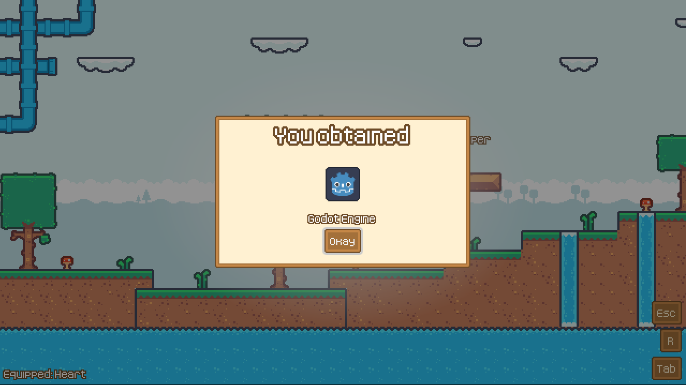
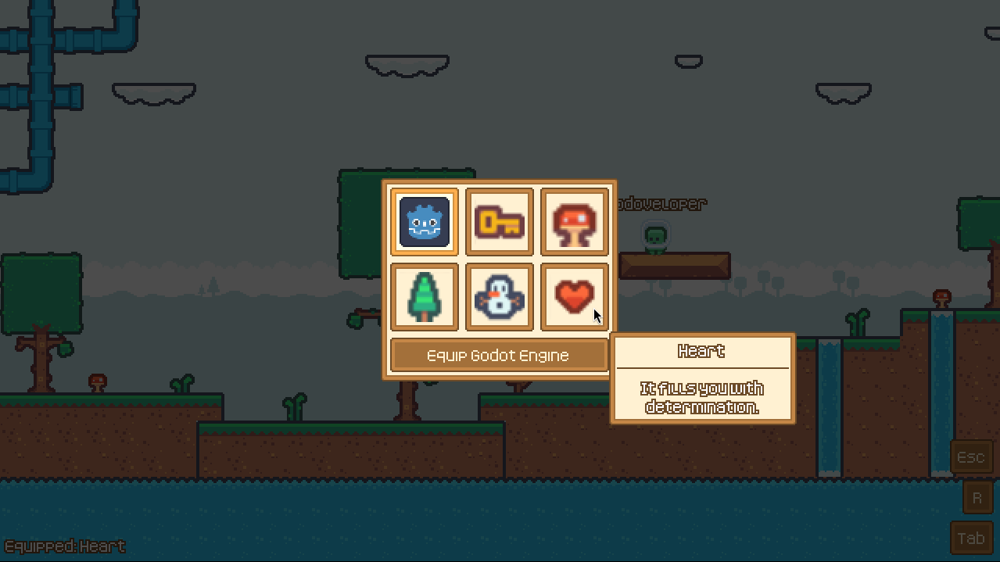

# Modular UI Architecture

Build Godot UI where every feature plugs in and unplugs cleanly.

An opinionated architecture and set of runtime systems for building modular, reusable, and
extensible UI in Godot 4.7, built on top of [Godular](addons/godular/README.md) (a DI/module
framework) and [GdbPromise](addons/gdb_promise/README.md) (a promise library).



## 🤯 The problem

UI tends to accumulate coupling as a game grows. A HUD script ends up with direct references to
the inventory, the quest log, and the pause menu; a new feature means editing scenes owned by
other systems; and removing a feature means hunting down every place that still reaches into it.

Escape closes three overlapping windows at once, a hotkey fires while a text field has focus,
and "don't show a popup while the game is paused" gets hardcoded into every popup instead of
declared once.

This addon addresses that by making UI **modular at the architecture level**: features register
what they need (a View, a HUD button, a keybinding) without editing the scenes they attach to,
and removing a feature's module removes everything it contributed — no dangling references.

## ✨ What you can do with it

Stop letting your HUD script know about the inventory, the quest log, and the pause menu. Here is
what you get instead:

- 🧩 **Add a feature without touching anyone else's scenes.** Drop in a module and it plugs a
  button into the HUD, a footer into the Inventory, or a whole new screen into the game. Remove the
  module and every trace of it disappears.
- 🔌 **Build a widget once, reuse it everywhere.** A "Close" button or a currency counter doesn't
  need to know which screen it's on. It reads what it needs from that screen's state.
- ⌨️ **Make a hotkey and its button behave the same.** Both go through one binding, scoped to the
  UI layer you're in. Typing in a text field never triggers a stray shortcut, and Escape closes
  one thing, not three.
- 💬 **Ship polished popups without writing the plumbing.** You get click-outside and Escape
  dismissal, nested popups that can block their parent, and a queue so five "item obtained"
  notifications show one after another instead of piling up.
- 🖱️ **Get hover tooltips that just work.** One tooltip at a time, anchored to what you're
  hovering, so you never end up with stacked or orphaned ones.
- 🏷️ **Pin UI to things in the game world.** Nameplates, health bars, and markers follow a world
  node every frame, while still living in your UI layer.
- 🚦 **Say "not right now" in one place.** Declare that popups are blocked while the game is
  paused, and any gated popup respects it. No `if paused` checks scattered through your code.

See the [concepts](docs/concepts/01-architecture-overview.md) section of the documentation for how
it all fits together.



## 🎯 Is this for you?

✅ **Likely useful for:** mid-to-large projects that will keep growing UI over time (RPGs,
management/sim games, live-service or moddable games), teams where different people own
different features, and projects comfortable with a DI/module-style architecture.

⚠️ **Probably not worth it for:** game jams and small games with a handful of screens. The
module/capability/registration structure costs more upfront than a handful of scenes and a
singleton would, and that cost only pays off once several independent features need to share UI
surfaces without stepping on each other.

## 📦 Requirements & installation

- Godot 4.7. [Godular](addons/godular/README.md) itself supports 4.5+; this addon has only been
  verified against 4.7.
- Install from the Godot **AssetLib** tab (search "Modular UI Architecture"), or copy
  `addons/modular_ui_architecture`, `addons/godular`, and `addons/gdb_promise` into your
  project's `addons/` folder.
- Enable the **Godular** plugin under Project Settings → Plugins. It adds the
  `GdlrModuleManager` autoload that this addon (and your own modules) run on.
- Enable the **Modular UI Architecture** plugin under the same Plugins page.
- See the [installation guide](docs/getting-started/02-installation.md) for the full steps.

## 🚀 Quick start

A minimal module that registers one View and mounts it, following the demo's own conventions:

```gdscript
# my_feature.md.gd
const GameUiModule = preload("res://addons/modular_ui_architecture/modules/game_ui/game_ui.md.gd")
const GameUiTypes = preload("res://addons/modular_ui_architecture/modules/game_ui/types.gd")

const MY_VIEW_PATH := "res://my_feature/my_view.tscn"
const MY_VIEW_TOKEN := &"my_view"

static var IMPORTS := [GameUiModule]


class MyFeatureModule extends GdlrModule:
	var reg_views: CapViewsRegistry
	var svc_game_ui: CapGameUi

	func register() -> void:
		reg_views.register_view(GameUiTypes.ViewRegistration.new(MY_VIEW_TOKEN, MY_VIEW_PATH))

	func enable() -> void:
		svc_game_ui.mount_view(MY_VIEW_TOKEN)
```

The [Quick start](docs/getting-started/03-quick-start.md) builds this feature in full, and the
[cookbook](docs/cookbook.md) has short recipes for Popups, Tooltips, Policy Store gating, and more.

## 🎮 The demo

`demo/` is a small playable project exercising every system. Run `demo/content/levels/main.tscn`
to try it.

## 📚 Documentation

Full user documentation lives in [`docs/`](docs/README.md). Start with the
[introduction](docs/getting-started/01-introduction.md) and the
[quick start](docs/getting-started/03-quick-start.md).

Contributors can read [CONTRIBUTING.md](CONTRIBUTING.md) before opening a pull request.

## 🛠️ Potential improvements

The addon is usable today, but a few things are still closed to projects that use it:

- **Custom Policy categories.** Today, a new `PolicyStoreTypes.Category` value means editing
  `policy_store/types.gd` in the addon. A project should be able to declare its own categories from
  its own modules. See [Policy Store](docs/guides/policy-store.md#the-categories).
- **Custom UI Layers.** Today, a new `UiLayer` value, and its `UiLayerNode` script, means editing
  files in `ui_layers/`. Layers should be registrable from a project's modules. See
  [Customizing a layer](docs/guides/ui-layers.md#customizing-a-layer).

## 🤖 AI disclosure

This project was developed with the assistance of AI tools. The majority of the code was
written by hand; AI was used for code review, help with architecture and design decisions, and
to assist with writing documentation.

Everything in this repository has been reviewed and is maintained by the author.

## 🙏 Credits

- Built on [Godular](addons/godular/README.md) and [GdbPromise](addons/gdb_promise/README.md) (both MIT)
- Demo art/fonts are from [Kenney](https://kenney.nl/)

## 📄 License

Distributed under the [MIT LICENSE](LICENSE).
