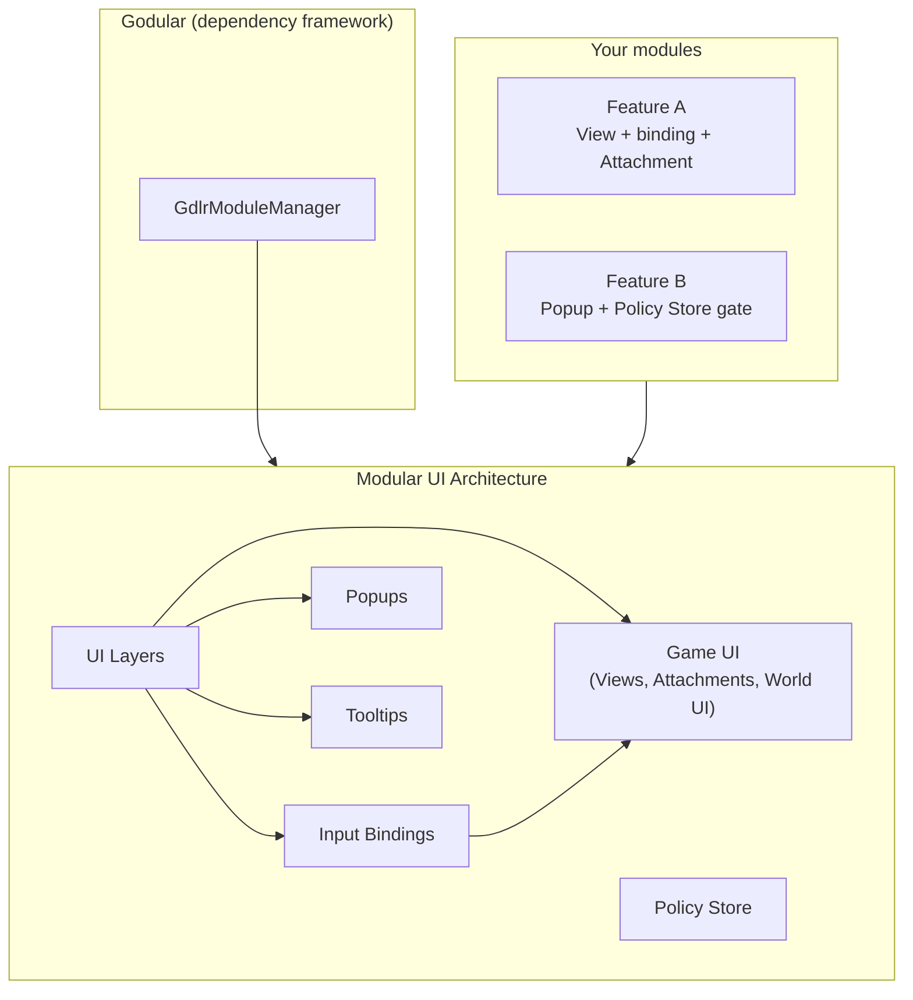
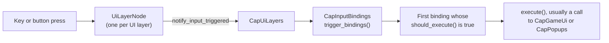

# Architecture overview

The addon is a set of **modules**, each providing capabilities that other code consumes through
dependency injection. This page shows how those modules fit together and why UI is split across
several systems instead of one.

## The big picture

- **Godular** creates your modules, wires their dependencies, and starts them in order. It is a
  separate project. See [Modules and capabilities](02-modules-and-capabilities.md).
- **UI Layers** own the ordered planes UI mounts into, and route raw input to them.
- **Input Bindings** map an input action to behaviour on a specific layer.
- **Game UI** mounts Views, places Attachments into their slots, and tracks World UI.
- **Popups**, **Tooltips**, and **Policy Store** are separate systems that depend on UI Layers. Your
  modules depend on any of them through their capabilities.

Your code depends only on the `Cap*` contracts, never on the concrete services behind them.

## Three mounting systems, on purpose

The addon has three systems that put UI on screen. They don't share one "modal" concept, because each
has different rules:

| System | Capability | What it is for | Rules it enforces |
|--------|------------|----------------|-------------------|
| Views | `CapGameUi` | Top-level UI such as a HUD, a menu, or an inventory. | One active instance per token. Attachments and Context apply to Views. |
| Popups | `CapPopups` | Dismissable overlays, dialogs, and notifications. | Click-outside and Escape dismissal, parent and child hierarchy, and an optional queue. |
| Tooltips | `CapTooltips` | Hover information about something under the cursor. | A single tooltip at a time, positioned against its anchor. |

Keeping them apart means a Popup's dismissal rules can't leak into a View, and a View's Attachments
can't end up in a tooltip. The reasoning is recorded in the
[project's architecture decisions](../../.agents/adrs/002-separate-popups-views-tooltips-subsystems.md).

## Where input goes

A key press and a button press both end at the same `trigger_bindings()` call. That is why a button
can run exactly what a key runs. The layer decides *which* bindings are eligible, and the binding decides
*whether* it runs. For the detail, see [UI Layers](../guides/ui-layers.md) and
[Input Bindings](../guides/input-bindings.md).

## The UI layers

Each layer is a fixed plane. Layers drawn later are on top and receive input first.

| Layer | Typical use |
|-------|-------------|
| `DEFAULT` | Fallback. |
| `HUD` | The HUD. |
| `HUD_OVERLAY` | Overlays drawn on top of the HUD. |
| `WINDOW` | Exclusive Views, such as a Pause Menu or an Inventory. Only one child at a time. |
| `OVERLAY` | Overlays above windows. |
| `POPUP` | Popups. |
| `TOOLTIP` | Tooltips, above everything else. |

The order is defined by the addon and can't be changed by your code. Each layer has its own node
script, so you can customize one layer's behaviour without touching the others. See
[UI Layers](../guides/ui-layers.md#customizing-a-layer) and
[Types and enums](../reference/types-and-enums.md#uilayer).

## Where the addon ends and your code begins

- **The addon provides:** the layers, the registries, the services, the base classes (`UiAttachment`,
  `InputBinding`, `Tooltip`), and the helper components.
- **Your project provides:** the scenes, the Views, the bindings, the Attachments, the input actions,
  and the bootstrap script.
- **The demo provides:** a worked example of all of the above. Its helper classes are not part of the
  addon. See the [demo tour](../getting-started/04-demo-tour.md).

## Next

Continue to [Modules and capabilities](02-modules-and-capabilities.md).
